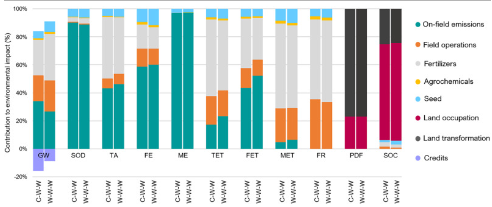
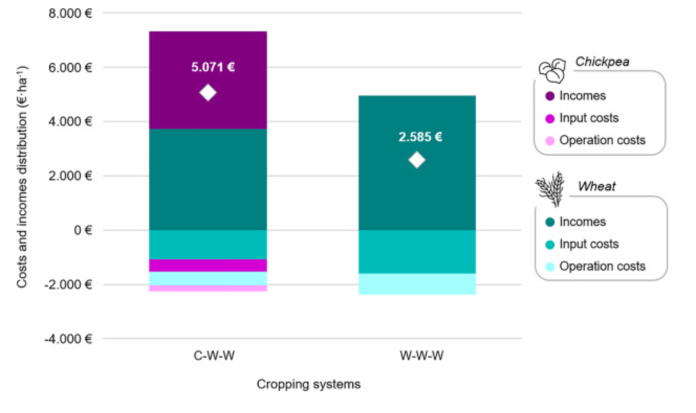
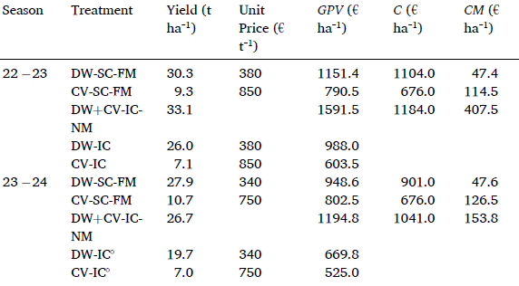
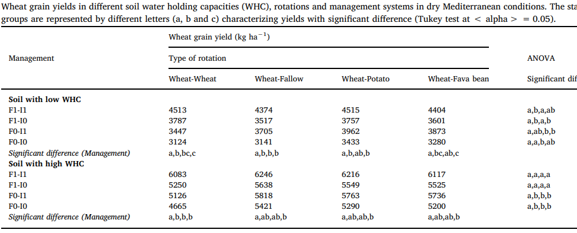

# Research Compilation: Bradano Valley

**Contents**

- [Scope](#scope)
- [EU and Italian Subsidies](#eu-and-italian-subsidies)
- [Market Prices and Profitability](#market-prices-and-profitability)
- [Coupled Income Support EU Policy Subsidies (full tables)](#coupled-income-support-eu-policy-subsidies-full-tables)

## Scope

Region: **Bradano valley, Basilicata, Southern Italy**

Background: **The Bradano river basin** covers 2,765 km², roughly a 53 × 53 km square, along a river 120 km long. It runs from near Forenza (province of Potenza) south-east past Acerenza, Oppido Lucano and Irsina to the Gulf of Taranto at Metaponto, across the provinces of Potenza, Matera and Taranto. La Generale cooperative, Genzano di Lucania (40.82460°N, 16.09348°E), your demo field, sits on its northern edge.

## EU and Italian Subsidies

EU Policies for farmers: The **Common Agricultural Policy (CAP)** is the European Union's unified agricultural subsidy and rural development program

- Our demo region is classified as a Less Developed region, GDP per capita below 75% of the EU average (economical constraints)
- much of the Alto Bradano consists of hilly, clay-rich inland terrain (physical constraint) -\> under Areas with Natural Constraints (ANC) they can apply for higher grant scoring (receive 10% to 20% more)

[https://agriculture.ec.europa.eu/media/news/cap-support-crucial-maintain-farming-areas-natural-constraints-shows-latest-study-2023-07-19\_en](https://agriculture.ec.europa.eu/media/news/cap-support-crucial-maintain-farming-areas-natural-constraints-shows-latest-study-2023-07-19_en)

Hence, farms and cooperatives in our region can qualify for higher EU co-financing rates and specialised territorial grants

Administrative process for the grant:

- **Farm Dossier (*Fascicolo Aziendale*):** First, the farmer must maintain an updated digital land registry on Italy's national agricultural portal (**SIAN**). Every parcel of land, lease agreement, and cadastral boundary in Genzano di Lucania must be mapped digitally. [https://interoperable-europe.ec.europa.eu/collection/egovernment/document/italian-informative-agricultural-system-agea-sian](https://interoperable-europe.ec.europa.eu/collection/egovernment/document/italian-informative-agricultural-system-agea-sian)

- Subsidy applications are uploaded onto SIAN, including for ANC (but a lot of farmers use a private firm CAA to help them fill in applications -\> [https://www.confagricoltura.it/eng/network-confagricoltura/farmer-s-confederation-system/agricultural-assistance-centre%E2%80%93-caa](https://www.confagricoltura.it/eng/network-confagricoltura/farmer-s-confederation-system/agricultural-assistance-centre%E2%80%93-caa))

- Italy uses the **Area Monitoring System (AMS)**, which uses Copernicus Sentinel satellites to verify throughout the year that the farmer actually planted what they claimed on their application

[https://consulenzaagricola.it/circolari/politica-agricola-comune-e-nazionale/20261-circolare-agea-su-area-monitoring-system-ams](https://consulenzaagricola.it/circolari/politica-agricola-comune-e-nazionale/20261-circolare-agea-su-area-monitoring-system-ams)

### Italy’s Common Agriculture Strategic Plan (2023-2027)

Subsidies:

1. baseline per-hectare payment regardless of what they plant
1. extra **Coupled Income Support** (*Sostegno Accoppiato al Reddito*) for specific vulnerable or strategic crops [https://faolex.fao.org/docs/pdf/ita236756.pdf](https://faolex.fao.org/docs/pdf/ita236756.pdf)

from [https://www.informea.org/en/content/legislation/italys-national-strategic-plan-cap-2023-2027](https://www.informea.org/en/content/legislation/italys-national-strategic-plan-cap-2023-2027) (Italy National Strategic Plan for CAP)

#### Eligible Crops Under Coupled Income Support (PD 06)

| **Code** | **Italian Official Name** | **English Translation** | **Planned Unit Rate (€/ha) \*2026** | **Planned Unit Rate** **(€/ha) \*2027** | **Key Translation of Eligibility Conditions** |
|---|---|---|---|---|---|
| **CIS(01)** | *Frumento duro* | **Durum Wheat** | **€93.50 / ha** |  | Must be cultivated in Central or Southern regions (*Toscana, Umbria, Marche, Lazio, Abruzzo, Molise, Campania, Puglia,* *Basilicata**, Calabria, Sicilia, Sardegna*) using certified seeds. Certified seeds for **2025:** [https://www.crea.gov.it/documents/63509/2367743/Specie-certificabili-07-10-2025.pdf/10a470d6-831e-a3e7-0d5f-d81518f9e9c3?t=1766054994158](https://www.crea.gov.it/documents/63509/2367743/Specie-certificabili-07-10-2025.pdf/10a470d6-831e-a3e7-0d5f-d81518f9e9c3?t=1766054994158) |
| **CIS(02)** | *Semi oleosi: colza e girasole* | **Oilseeds: Rapeseed and Sunflower** | **€64.30 / ha** |  | Must be cultivated under supply chain contracts with processing or seed companies using certified seeds (excluding rapeseed grown in protected zones). |
| **CIS(03)** | *Riso* | **Rice** | **€336.46 / ha** |  | Eligible across the national territory for surfaces sown with certified rice seed varieties. |
| **CIS(04)** | *Barbabietola da zucchero* | **Sugar Beet** | **€657.93 / ha** |  | Must be cultivated under supply contracts with sugar manufacturing companies using certified seeds. |
| **CIS(05)** | *Pomodoro da trasformazione* | **Processing Tomatoes** | **€173.64 / ha** |  | Must be delivered to processing industries via contracts signed through a recognised Producer Organisation (OP) using certified seedlings/seeds. *(Updated in Version 4.1).* |
| **CIS(06)** | *Agrumi* | **Citrus Fruits** | **€150.85 / ha** |  | Specialized citrus groves (*agrumeti specializzati*) belonging to a recognised Producer Organisation or holding PDO/PGI (*DOP/IGP*) quality certification. |
| **CIS(07)** | *Olivo* | **Olive Groves** | **€116.97 / ha** |  | Olive groves adhering to a PDO/PGI (*DOP/IGP*) specification. In **Puglia and Calabria**, eligibility is restricted to olive groves located on land with an average slope greater than 7.5% (*pendenza \> 7,5%*). |
| **CIS(08)** | *Colture proteiche e leguminose da granella* | **Protein Crops and Grain Legumes** | **€40.04 / ha** |  | Includes chickpeas, lentils, peas, fava beans, lupins, beans, and annual forage legumes (alfalfa/clover), excluding soybeans. [https://www.sciencedirect.com/science/article/pii/S0048969723037476](https://www.sciencedirect.com/science/article/pii/S0048969723037476) |
| **CIS(09)** | *Soia* | **Soybeans** | **€75.34 / ha** |  | Geographically restricted to Northern regions (*Piemonte, Lombardia, Veneto, Friuli-Venezia Giulia, Emilia-Romagna*) using certified seeds. |
| **CIS(10)** | *Colture proteiche (altro / erba medica)* | **Other Protein / Forage Legume Crops** | **€38.00–€40.04 / ha** |  | Covers specific rotational leguminous forage crops (*leguminose foraggere*) aimed at improving soil nitrogen fixation and protein self-sufficiency. |

\*see [below](#coupled-income-support-eu-policy-subsidies-full-tables) for the tables of the full info

#### Additional Eco-Scheme Crop Top-Ups (PD 05 – *Ecoschemi*)

In addition to Coupled Income Support, the document translates specific higher-rate environmental payments (**Eco-Schemes**) tied to certain crop types:

- **Eco-Scheme 2 (*Inerbimento delle colture arboree*– Grass Cover in Tree Crops):** Provides extra per-hectare payments (**~€120/ha** standard rate) for **permanent tree crops** (such as olives, citrus, vineyards, almonds, and fruit orchards) where farmers maintain spontaneous or sown grass cover between tree rows without chemical weeding.

- **Eco-Scheme 3 (*Salvaguardia olivi di particolare valore paesaggistico*– Protection of Landscape Olive Groves):** Provides a dedicated payment (**~€220/ha**) specifically for **historic or landscape-value olive groves** pruned at least once every two years without burning pruning residues on site.

- **Eco-Scheme 4 (*Sistemi foraggeri estensivi con avvicendamento*– Extensive Forage Systems with Crop Rotation):** Pays **~€110/ha** for arable land rotated with **leguminous and forage crops** (such as alfalfa, clover, or grain legumes) without the use of synthetic plant protection products.

- **Eco-Scheme 5 (*Misure specifiche per gli impollinatori*– Specific Measures for Pollinators):** Pays **~€250/ha** (arable land) to **~€500/ha** (tree crops) for planting **melliferous (nectar- and pollen-producing) cover crops** on field margins or between orchard rows.

#### Durum Wheat Supply Chain Bonus (Fondo Grano Duro)

Through MASAF decrees (such as DM n. 677535), for farmers who sign three-year supply chain contracts with agricultural businesses (*contratti di filiera*) and use certified seeds. They can receive an indicative maximum aid amount of **€100/ha of durum wheat**, up to a limit of 50 hectares per beneficiary. However, if eligible applications require a greater budget than the allocated amount, the per-hectare aid will be reduced linearly.

Aid is granted up to a maximum of €50,000 over a period of three fiscal years.

Agricultural businesses they must sign with to be eligible:

- **Cooperatives** (*cooperative*)
- **Consortia** (*consorzi*)
- **Producer Organizations** (*Organizzazioni di produttori*)
- **Processing companies directly** (*direttamente con le imprese di trasformazione*), such as mills or pasta manufacturers

[https://informatoreagrario.it/seminativi/confermato-il-contributo-per-la-filiera-del-grano-duro/](https://informatoreagrario.it/seminativi/confermato-il-contributo-per-la-filiera-del-grano-duro/) (March 3, 2026)

[https://www.confagricolturaro.it/confagricoltura-informa/tecnico/pac-e-psr/grano-duro-aiuto-de-minimis-2025/](https://www.confagricolturaro.it/confagricoltura-informa/tecnico/pac-e-psr/grano-duro-aiuto-de-minimis-2025/) (May 16, 2025)

Seed certification list:

[https://www.crea.gov.it/documents/63509/2367743/Specie-certificabili-07-10-2025.pdf/10a470d6-831e-a3e7-0d5f-d81518f9e9c3?t=1766054994158](https://www.crea.gov.it/documents/63509/2367743/Specie-certificabili-07-10-2025.pdf/10a470d6-831e-a3e7-0d5f-d81518f9e9c3?t=1766054994158)

## Market Prices and Profitability

### Incorporation of legume-type crops can provide economic benefits due to their nitrogen fixation capabilities

#### Environmental and Economic Benefits of Wheat–Chickpea Rotation in Apulia, Italy (2023)

[https://www.sciencedirect.com/science/article/pii/S0048969723037476](https://www.sciencedirect.com/science/article/pii/S0048969723037476)

- Accounts for machinery cost
- Emphasises wheat-chickpea rotation, and not intercropping! -\> intercropping with chickpea requires more expenses for sorting machinery

Env impact:

Economic impact:

**Table S1.** Field operations and inventory data (per hectare) for wheat cultivation.

| Stage | Operation | Tractor (A): weight & power | Implement (B): tillage item | Implement (B): weight (kg) | A+B: effective work capacity (h·ha-1) | A+B: fuel diesel consumption (L·ha-1) | Input rates | Labor cost (€·ha-1) | Input cost |
|---|---|---|---|---|---|---|---|---|---|
| *Field conditioning* | Shredding | 1950 *kg* 40 *kW* | Shredder | 716 | 2.30 | 8.05 | -- | 43.5 | -- |
|  | Mineral Fertilization | 1950 *kg* 40 *kW* | Fertilizer spreader | 125 | 0.15 | 0.45 | Diammonium phosphate (DAP) 18-46-0: 200 kg·ha-1 | 34.75 | 1.02 €·kg-1 |
|  | Minimum Tillage | 7870 *kg* 153 *kW* | Rotatory tiller | 1500 | 2.00 | 42.00 | -- | 15.05 | -- |
|  | Seeding | 600 *kg* 24 *kW* | Seeder | 300 | 6.00 | 19.80 | Seeds: 180 kg·ha-1 | 13.2 | 0.515 €·kg-1 |
| *Crop growth* | Herbicide Treatment | 1950 *kg* 40 *kW* | Trailed sprayer | 500 | 0.15 | 0.45 | Atlantis® (metsulfuron-methyl 30 g·l-1 and iodosulfuron methyl-sodium 6 g·l-1): 0.500 kg∙ha-1; Biopower® (sodium lauryl ether sulphate 27,65% p/v):  1 L∙ha-1 | 20.85 | 40 €·L-1 and 4 €·L-1 |
|  | Mineral Fertilization | 1950 *kg* 40 *kW* | Trailed sprayer | 125 | 0.15 | 0.45 | Ammonium nitrate (AN) 34-2: 0.2 t·ha-1 | 34.75 | 1.05 €·kg-1 |
|  | Herbicide Treatment | 1950 *kg* 40 *kW* | Trailed sprayer | 500 | 0.15 | 0.45 | Buctril® (bromoxynil and 2,4-D 225 g·l-1): 500 ml·ha-1 | 19.6 | 11 €·L-1 |
| *Harvesting* | Harvesting | 2500 *kg* 38 *kW* | Harvester | -- | 4.33 | 23.65 | -- | 72.5 | -- |

**Table S2.** Field operations and inventory data (per hectare) for chickpea cultivation.

| Stage | Operation | Tractor (A): weight & power | Implement (B): tillage item | Implement (B): weight (kg) | A+B: effective work capacity (h·ha-1) | A+B: fuel diesel consumption (L·ha-1) | Input rates | Labor cost (€·ha-1) | Input cost |
|---|---|---|---|---|---|---|---|---|---|
| *Field conditioning* | Shredding | 1950 *kg* 40 *kW* | Shredder | 716 | 2.30 | 8.05 | -- | 43.5 | -- |
|  | Mineral Fertilization | 1950 *kg* 40 *kW* | Fertilizer spreader | 125 | 0.15 | 0.45 | Diammonium phosphate (DAP) 18-46-0: 300 kg·ha-1 | 34.75 | 1.02 €·kg-1 |
|  | Minimum Tillage | 7870 *kg* 153 *kW* | Rotatory tiller | 1500 | 2.00 | 42.00 | -- | 15.05 | -- |
|  | Seeding | 600 *kg* 24 *kW* | Seeder | 300 | 6.00 | 19.80 | Seeds: 60-80 kg·ha-1 | 13.2 | 0.95 €·kg-1 |
| *Crop growth* | Herbicide Treatment | 1950 *kg* 40 *kW* | Trailed sprayer | 500 | 0.15 | 0.45 | Corum® (Bentazone 480 g·l-1 and Imazamox 2.24% p/v.): 1.25 l∙ha-1 | 20.85 | 59 €·L-1 |
|  | Herbicide Treatment | 1950 *kg* 40 *kW* | Trailed sprayer | 500 | 0.15 | 0.45 | Coprantol® 30%: 1 kg·ha-1 | 19.6 | 10.37 €·L-1 |
| *Harvesting* | Harvesting | 2500 *kg* 38 *kW* | Harvester | -- | 4.33 | 23.65 | -- | 72.5 | -- |

**Table S3.** Crop yields in the systems analyzed.

| **System** | **Crop** | **Year 1** **(t·ha****-1****)** | **Year 2** **(t·ha****-1****)** | **Year 3** **(t·ha****-1****)** |
|---|---|---|---|---|
| Monoculture | Wheat grain | 5 | 5 | 5 |
|  | Wheat straw | 3.5 | 3.5 | 3.5 |
| Rotation | Wheat grain | - | 5.8 | 5.5 |
|  | Wheat straw | - | 4 | 3.8 |
|  | Chickpea grain | 4 | - | - |
|  | Chickpea straw | 3 | - | - |
| *Wheat grain yield variation between monoculture and rotation* |  | - | 16 % | 10 % |

**Table S5**. Environmental profile of cropping systems based on one hectare. C-W-W: rotation system; W-W-W: monoculture system.

| **Impact category** | **Acronym** | **Unit** | **C-W-W** | **W-W-W** |
|---|---|---|---|---|
| Global Warming | GW | t CO2 eq | 4.42 | 5.37 |
| Terrestrial Acidification | TA | kg SO2 eq | 82.90 | 81.43 |
| Freshwater Eutrophication | FE | kg P eq | 2.36 | 2.68 |
| Marine Eutrophication | ME | kg N eq | 37.44 | 43.27 |
| Terrestrial Ecotoxicity | TET | t 1,4-DCB | 21.01 | 23.41 |
| Freshwater Ecotoxicity | FET | kg 1,4-DCB | 283.92 | 353.92 |
| Marine Ecotoxicity | MET | kg 1,4-DCB | 223.15 | 240.26 |
| Stratospheric Ozone Depletion | SOD | g CFC-11 eq | 88.08 | 97.39 |
| Fossil resource scarcity | FR | t oil eq | 0.98 | 1.04 |
| Soil Organic Carbon Deficit Potential | SOC | t SOC deficit·year | 23.69 | 26.51 |
| Global Potential Species Loss | PDF | Potential species loss·year | 1.25·10-8 | 1.26·10-8 |

#### Durum wheat-vetch intercropping in Mediterranean agroecological systems: Effects on yield, nitrogen balance, and farm profitability (2023-24)

[https://doi.org/10.1016/j.ijagro.2025.100045](https://doi.org/10.1016/j.ijagro.2025.100045)

Main points:

Production costs (C) included all variable expenses related to seed, soil preparation, sowing, harvesting, and pesticide applications, as well as additional operations such as[mechanical weed control](https://www.sciencedirect.com/topics/agricultural-and-biological-sciences/mechanical-weed-control), seed separation, and post-harvest handling.

Contribution Margin = Gross Production Value (GPV) − Production Costs

| **Growing season** | **Cropping system** | **GPV (€/ha)** | **Costs (€/ha)** | **CM (€/ha)** |
|---|---|---|---|---|
| 2022–2023 | Durum wheat monoculture (full input) | 1,151.4 | 1,104 | 47.4 |
| 2022–2023 | Common vetch monoculture (full input) | 790.5 | 676 | 114.5 |
| 2022–2023 | Durum wheat–vetch intercrop (no input) | 1,591.5 | 1,184 | 407.5 |
| 2023–2024 | Durum wheat monoculture (full input) | 948.6 | 901 | 47.6 |
| 2023–2024 | Common vetch monoculture (full input) | 802.5 | 676 | 126.5 |
| 2023–2024 | Durum wheat–vetch intercrop (no input) | 1,194.8 | 1,041 | 153.8 |

**Average contribution margin across both seasons**

| **Cropping system** | **Average CM (€/ha)** |
|---|---|
| Durum wheat–vetch intercrop | **280.6** |
| Common vetch monoculture | 120.5 |
| Durum wheat monoculture | 47.5 |

**Key findings**

- The durum wheat–vetch intercrop achieved the highest average contribution margin of €280.6/ha, compared with €47.5/ha for fertilised durum wheat monoculture and €120.5/ha for fertilised common vetch monoculture.
- The intercrop remained the most profitable system in both seasons. Its contribution margin declined from €407.5/ha in 2022–2023 to €153.8/ha in 2023–2024, reflecting less favourable growing conditions.
- Although intercropping incurred additional post-harvest seed separation costs, these were offset by the combined revenue from wheat and vetch and reduced input expenditure.
- The study suggests that combining durum wheat and common vetch can improve farm-level economic returns under low-input Mediterranean conditions.

#### Performance of wheat-based cropping systems and economic risk of low relative productivity assessment in a sub-dry Mediterranean environment (2019) - in Lebanon though

[https://doi.org/10.1016/j.eja.2019.125968](https://doi.org/10.1016/j.eja.2019.125968)

> [!NOTE]
> The pricing and profitability figures from this study (Lebanese farmer-survey prices in US$) have been removed. They are not a good proxy for Italian fava bean prices.

**Wheat grain yields**

**Other important findings**

- The wheat–faba bean rotation produced more protein than continuous wheat cultivation, with 0.93 versus 0.80 t/ha under low-WHC soils, and 1.34 versus 1.17 t/ha under high-WHC soils.
- The wheat–faba bean system demonstrated better resource-use efficiency and lower economic risk than continuous wheat cultivation.
- The study found that wheat–fava bean rotation was a more sustainable alternative to continuous wheat, particularly under less intensive nitrogen management.

---

### Extras

#### Pulse-included diverse crop rotations improved the systems economic profitability: evidenced in two 4-year cycles of rotation experiments

[https://link.springer.com/article/10.1007/s13593-022-00831-2](https://link.springer.com/article/10.1007/s13593-022-00831-2)

Main points:

- Research conducted in Canadian monoculture wheat-wheat farms
- Switching to pulse crops reduces expenses up to 38% (because nitrogen fertilisers are one of the main variable expenses in agriculture, both in Canada and also in cereal farms in Italy [https://rica.crea.gov.it/download.php?id=1922](https://rica.crea.gov.it/download.php?id=1922))
- However, the authors also noted that increasing pulse frequency raised pesticide expenses (especially for chickpea disease management) and warned that overly frequent pulse planting can increase pest and disease risks over time -\> basically need to be careful about how we space out the planting

## Coupled Income Support EU Policy Subsidies (full tables)

Top Header & Section Title

#### Coupled Income Support per Area — Durum Wheat

| **Description** | **2023** | **2024** | **2025** | **2026** | **2027** | **Total 2023–2027** |
|---|---|---|---|---|---|---|
| **Planned unit amount** *(EUR/ha)* | 93.50 | 93.50 | 93.50 | 93.50 | 96.88 | — |
| **Minimum amount for the planned unit amount** | 84.15 | 84.15 | 84.15 | 84.15 | 87.19 | — |
| **Maximum amount for the planned unit amount (in EUR)** | 102.86 | 102.86 | 102.86 | 102.86 | 106.57 | — |
| **O.10 (unit: Hectares)** | 977,018.00 | 977,018.00 | 977,018.00 | 977,018.00 | 977,018.00 | — |
| **Planned output × Planned unit amount** | 91,351,183.00 | 91,351,183.00 | 91,351,183.00 | 91,351,183.00 | 94,653,503.84 | 460,058,235.84 |

Here is the complete English translation of the three crop tables in your document—covering **Rice**, **Sugar Beet**, and **Processing Tomato**—followed by an explanation of the minimum/maximum amounts and row units.

#### Coupled Income Support per Area — Rice (PD 06 - CIS(02))

- **Left Column:PUA - PD 06 - 02 - Coupled support for rice (Uniform)**

| **Description** | **2023** | **2024** | **2025** | **2026** | **2027** | **Total 2023–2027** |
|---|---|---|---|---|---|---|
| **Planned unit amount** | 336.46 | 336.46 | 336.46 | 336.46 | 348.61 | — |
| **Minimum amount for the planned unit amount** | 302.81 | 302.81 | 302.81 | 302.81 | 313.75 | — |
| **Maximum amount for the planned unit amount (in EUR)** | 370.11 | 370.11 | 370.11 | 370.11 | 383.47 | — |
| **O.10 (unit: Hectares)** | 220,191.00 | 220,191.00 | 220,191.00 | 220,191.00 | 220,191.00 | — |
| **Planned output × Planned unit amount** | 74,085,463.86 | 74,085,463.86 | 74,085,463.86 | 74,085,463.86 | 76,760,784.51 | 373,102,639.95 |

#### Coupled Income Support per Area — Sugar Beet (PD 06 - CIS(03))

| **Description** | **2023** | **2024** | **2025** | **2026** | **2027** | **Total 2023–2027** |
|---|---|---|---|---|---|---|
| **Planned unit amount** | 657.93 | 657.93 | 657.93 | 657.93 | 681.70 | — |
| **Minimum amount for the planned unit amount** | 592.14 | 592.14 | 592.14 | 592.14 | 613.53 | — |
| **Maximum amount for the planned unit amount (in EUR)** | 723.72 | 723.72 | 723.72 | 723.72 | 749.87 | — |
| **O.10 (unit: Hectares)** | 30,396.00 | 30,396.00 | 30,396.00 | 30,396.00 | 30,396.00 | — |
| **Planned output × Planned unit amount** | 19,998,440.28 | 19,998,440.28 | 19,998,440.28 | 19,998,440.28 | 20,720,953.20 | 100,714,714.32 |

#### Coupled Income Support per Area — Processing Tomato (PD 06 - CIS(04))

| **Description** | **2023** | **2024** | **2025** | **2026** | **2027** | **Total 2023–2027** |
|---|---|---|---|---|---|---|
| **Planned unit amount (EUR)** | 173.64 | 173.64 | 173.64 | 173.64 | 179.91 | — |
| **Minimum amount for the planned unit amount** | 156.28 | 156.28 | 156.28 | 156.28 | 161.92 | — |
| **Maximum amount for the planned unit amount (in EUR)** | 191.00 | 191.00 | 191.00 | 191.00 | 197.90 | — |
| **O.10 (unit: Hectares)** | 60,205.00 | 60,205.00 | 60,205.00 | 60,205.00 | 60,205.00 | — |
| **Planned output × Planned unit amount** | 10,453,996.20 | 10,453,996.20 | 10,453,996.20 | 10,453,996.20 | 10,831,481.55 | 52,647,466.35 |

#### Coupled Income Support per Area — Olive (PD 06 - CIS(07))

| **Description** | **2023** | **2024** | **2025** | **2026** | **2027** | **Total 2023–2027** |
|---|---|---|---|---|---|---|
| **Planned unit amount** *(EUR/ha)* | 116.97 | 116.97 | 116.97 | 116.97 | 121.20 | — |
| **Minimum amount for the planned unit amount** | 105.27 | 105.27 | 105.27 | 105.27 | 109.08 | — |
| **Maximum amount for the planned unit amount (in EUR)** | 128.67 | 128.67 | 128.67 | 128.67 | 133.32 | — |
| **O.10 (unit: Hectares)** | 101,026.00 | 101,026.00 | 101,026.00 | 101,026.00 | 101,026.00 | — |
| **Planned output × Planned unit amount** | 11,817,011.22 | 11,817,011.22 | 11,817,011.22 | 11,817,011.22 | 12,244,351.20 | 59,512,396.08 |

#### Coupled Income Support per Area — Protein Crops: Soybean (PD 06 - CIS(08))

| **Description** | **2023** | **2024** | **2025** | **2026** | **2027** | **Total 2023–2027** |
|---|---|---|---|---|---|---|
| **Planned unit amount** *(EUR/ha)* | 136.32 | 136.32 | 136.32 | 136.32 | 141.25 | — |
| **Minimum amount for the planned unit amount** | 122.69 | 122.69 | 122.69 | 122.69 | 127.12 | — |
| **Maximum amount for the planned unit amount (in EUR)** | 149.95 | 149.95 | 149.95 | 149.95 | 155.37 | — |
| **O.10 (unit: Hectares)** | 225,689.00 | 225,689.00 | 225,689.00 | 225,689.00 | 225,689.00 | — |
| **Planned output × Planned unit amount** | 30,765,924.48 | 30,765,924.48 | 30,765,924.48 | 30,765,924.48 | 31,878,571.25 | 154,942,269.17 |

#### Coupled Income Support per Area — Protein Crops: Legumes excluding Soybean (PD 06 - CIS(09))

| **Description** | **2023** | **2024** | **2025** | **2026** | **2027** | **Total 2023–2027** |
|---|---|---|---|---|---|---|
| **Planned unit amount** *(EUR/ha)* | 40.04 | 40.04 | 40.04 | 40.04 | 41.48 | — |
| **Minimum amount for the planned unit amount** | 29.00 | 29.00 | 29.00 | 29.00 | 30.04 | — |
| **Maximum amount for the planned unit amount (in EUR)** | 44.04 | 44.04 | 44.04 | 44.04 | 45.63 | — |
| **O.10 (unit: Hectares)** | 978,053.00 | 978,053.00 | 978,053.00 | 978,053.00 | 978,053.00 | — |
| **Planned output × Planned unit amount** | 39,161,242.12 | 39,161,242.12 | 39,161,242.12 | 39,161,242.12 | 40,569,638.44 | 197,214,606.92 |

#### Coupled Income Support per Area — Legumes (except Soybeans) (PD 06 - CIS(04))

| **Description** | **2023** | **2024** | **2025** | **2026** | **2027** | **Total 2023–2027** |
|---|---|---|---|---|---|---|
| **Planned unit amount** *(EUR/ha)* | 40.04 | 40.04 | 40.04 | 40.04 | 41.48 | — |
| **Minimum amount for the planned unit amount** *(EUR/ha)* | 29.00 | 29.00 | 29.00 | 29.00 | 30.04 | — |
| **Maximum amount for the planned unit amount** *(EUR/ha)* | 44.04 | 44.04 | 44.04 | 44.04 | 45.63 | — |
| **O.10 (unit: Hectares)** | 978,053.00 | 978,053.00 | 978,053.00 | 978,053.00 | 978,053.00 | 4,890,265.00 |
| **Planned output × Planned unit amount** | 39,161,242.12 | 39,161,242.12 | 39,161,242.12 | 39,161,242.12 | 40,569,638.44 | 197,214,606.92 |

#### Units for Every Row in the Tables

| **Row Label** | **Unit** | **What It Measures** |
|---|---|---|
| **Planned unit amount** | **EUR / hectare (€/ha)** | Target annual subsidy paid to a farmer per eligible hectare. |
| **Minimum amount for the planned unit amount** | **EUR / hectare (€/ha)** | Lowest allowed per-hectare payout (−10% floor). |
| **Maximum amount for the planned unit amount** | **EUR / hectare (€/ha)** | Highest allowed per-hectare payout (+10% ceiling). |
| **O.10 (unit: Hectares)** | **Hectares (ha)** | EU output indicator **O.10** (*Number of hectares benefitting from coupled income support*). |
| **Planned output × Planned unit amount** | **Total EUR (€)** | Estimated total expenditure (Hectares × €/ha). |
